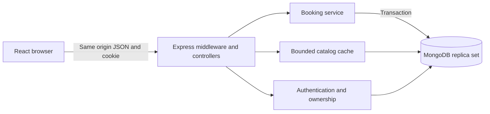

# GlobeTrek architecture

## Data choices

Users and bookings grow independently and are separate collections. Room types are small, bounded, and read with their hotel, so they are embedded. Inventory is referenced separately because it grows per room type per date and receives frequent conditional writes. Bookings snapshot names and prices so later catalog changes do not rewrite reservation history.

Unique indexes protect `(roomTypeId,date)`, `(user,idempotencyKey)`, email, and hotel slug. A `(user,createdAt)` index supports booking history. The city/price index helps filtered sorting; literal case-insensitive substring search can scan and is acceptable for six hotels. Do not claim it is index-backed full-text search.

## Reservation transaction

1. Normalize and validate the request. Hash the parsed payload using SHA-256. Check for an existing retry key.
2. Begin a transaction and recheck the key inside its snapshot.
3. Read the selected hotel/room; validate capacity and dates. Compute the price with integer arithmetic.
4. For each night, update only when `booked + requested <= total`. Increment `booked`. Missing inventory or no matching conditional update aborts all previous increments.
5. Insert the confirmed booking and commit with majority write concern. The driver handles transient transaction retries. A duplicate-key race rereads the winning booking and checks its fingerprint.

Availability before booking is a hint: two users can both see the last room. The guarded write inside the transaction is the authority. An overlap query alone cannot prevent concurrent read-then-write races. Overlapping bookings by the same user are allowed because travelers may book rooms for others; inventory, rather than personal schedule, is the constraint.

## Cancellation transaction

Find the booking by both its ID and logged-in owner. If already cancelled, return it. Otherwise decrement each recorded night with a nonnegative guard and persist cancelled status in the same transaction. Concurrent cancellations conflict on the booking/inventory documents; a retry observes the cancelled state. Missing inventory aborts cancellation rather than silently corrupting counts.

## Complexity and cache

For N stay nights, date generation is O(N) space/time and booking performs N conditional writes; N is bounded at 14. The cache uses a JavaScript Map for average O(1) get/set and deterministic oldest-insertion eviction. It stores at most 100 normalized query results for 60 seconds. It is neither shared across instances nor a durable source of truth. Private data and availability bypass it.

## Security and operational limits

Bcrypt cost 12 hashes passwords; JWT signs a two-hour session, not encrypted user data. The HTTP-only cookie reduces token exposure to JavaScript. SameSite cookies and exact Origin checks protect mutation requests; neither prevents XSS, so the application also uses React's escaping and Helmet's security headers. A database token version makes logout effective for previously issued tokens, at the cost of one user lookup per authenticated request. Logout signs out all devices.

The production process trusts one upstream proxy for Render; revisit that setting on other infrastructure. Structured logs contain only request ID, method, route template, status, and duration. They are a source for request counts; there is no public metrics endpoint or guaranteed long-term log retention. No secrets, query strings, or request bodies are logged.

Production work beyond this MVP includes verified email/recovery, audited backups/restores, persistent monitoring, staff operations, shared rate limiting, rolling inventory scheduling, payment reconciliation, accessibility review, and higher-volume capacity testing. No infrastructure is provisioned automatically.
