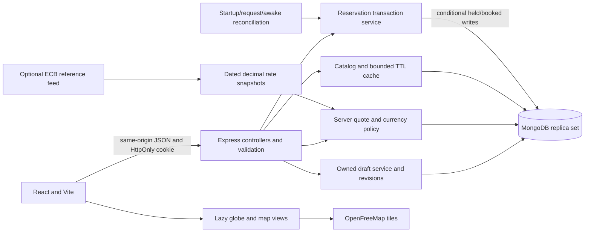

# GlobeTrek architecture

## State ownership

React Query owns remote state; the planner reducer owns draft edits. Public filters live in URL parameters. Guest drafts and browser backups are versioned locally; private trip data is stored by owner and revision. Authentication cancels outstanding queries and removes other cached data while preserving the observed session query. New-session data must not expose the previous user's cache.

Geographic engines consume the same entity IDs as lists and day stops. A route is derived, not a second itinerary model. Supported countries also have button/list access; geographic rendering failure does not block planning.

## Domain and indexes

Tour products describe experiences; departures own seat counts and UTC schedule instants. Hotels embed room types; each local night owns stock. Packages reference these same resources and add departure capacity. Templates are published versions copied into independent drafts.

Unique indexes protect user email, room/date, tour/date, package/date and user/idempotency key. Partial unique reservation indexes permit one pending hold/account and one pending/confirmed reservation/trip. Geographic points use 2dsphere indexes. Quote cleanup uses a TTL index; capacity records and pending reservations are never TTL-deleted.

## Reservation lifecycle

1. Validate owned source, revision, country, party, local dates, overlapping stays/tours and resolved departures.
2. Create a ten-minute server-priced quote with line items, aggregated demands, currency/fee/estimate snapshots and earliest start. No stock changes.
3. Hold: reconcile due holds, reread the owned quote and trip inside a transaction, check expiry/revision and write a trip fence against concurrent edits/deletion.
4. Sort demand keys and reserve only if booked + held + requested <= total. Missing stock fails closed. Insert the pending snapshot in the same transaction. Any failure rolls everything back.
5. Confirm before the persisted deadline: held decreases and booked increases together. Deadlines are checked again on driver transaction retries. Confirmation replay does not increment twice.
6. Expiry releases held quantities; confirmed cancellation releases booked quantities before the earliest start. Status and counters change transactionally. Repeated workers/cancellations cannot release twice.

The browser retains one key for retries of the same quote. Changed payloads conflict. A lost response is reconciled through reservation status or the same-key retry. No external network side effects occur inside a retried database transaction.

## Time money and content

Trip days are inclusive civil dates; hotel checkout is exclusive. Hotel stock dates label local nights. Tour instants are UTC plus IANA timezone; ambiguous/nonexistent local schedule times are rejected. Money uses explicit minor-unit metadata and safe integer boundaries. Decimal arithmetic handles reference-rate conversion and rounding. INR estimates never determine billed amounts. The 12% service fee is educational, not a claim about local tax law.

Stable import IDs, published content versions, insert-only capacity and generation horizons preserve bookings. Historical stock holes are not regenerated as empty capacity. Daily extension maintains future stock while awake; request/startup expiry recovery supplements the periodic worker on sleeping hosting.

## Cache complexity and limits

The catalog Map holds at most 100 normalized query results for 60 seconds with deterministic oldest-entry eviction. Age headers preserve the original freshness budget. Availability, drafts, quotes and reservations bypass public caching. The cache is per-process and disposable.

For R resource demands, aggregation uses a Map, sorting costs O(R log R), and transaction work is O(R) sequential database writes. Trips and stop counts are bounded. Catalogs are small editorial datasets; geographic filtering is indexed, name search is escaped, results are paginated and sorting is allowlisted. No Redis, search cluster or microservices are required here.

## Security and operational boundaries

Bcrypt cost 12; expiring JWT in HttpOnly/SameSite cookie (Secure in production); exact mutation-Origin validation; ownership checks; authentication/reservation/general rate limits; request IDs; explicit redacted log fields. Logout invalidates all issued tokens through the user's token version. CSP permits only the map provider connections needed by the bundled worker and retains same-origin script restrictions.

Free hosting may sleep. Cleanup is bounded and delayed while idle; late confirmation is still rejected. This demo has no continuous-worker SLA, live payment processor, supplier guarantees or production customer data. Application rollback does not undo data migrations or justify resetting inventory.

Legacy hotel-only bookings keep original IDs, retry hashes, snapshots and cancellation behavior. New UI reservations use the shared quote/hold lifecycle. Legacy listings remain India-only and retain their historical date/room limits.
