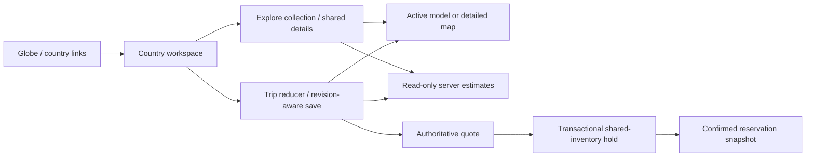

# Country workspace engineering

The country route owns navigation; the trip editor continues to own draft changes and autosaving. The geographic renderer receives presentation data and never changes inventory.

## Route and state ownership

`/countries/:code` supports `mode=explore|plan`, `view=model|map|list`, `kind`, `q`, `cityId`, `place` (preview selection), `item` (full detail panel), `trip=local|owned-id`, `day` and product selection parameters. Only references and public controls are in the URL. `new=1` requests explicit new-trip setup, including a confirmation before replacing a browser draft.

Compatibility routes `/planner/new`, `/planner/:id`, `/discover/:kind/:id` and `/hotels/:id` resolve to the relevant country workspace. Owned-trip lookup stays authenticated. Existing auth-return and reservation intent handling remain in use.

Explore stays mounted while Plan is active, and a visited trip editor stays mounted while Explore is active. Hidden modes do not mount their geographic engine. The camera is captured on engine disposal and passed to the next country model. The editor keeps its reducer, serialized autosaves, revision conflicts, browser backups and save-as-copy behavior. Dates can expand a trip without discarding stops; narrowing dates that would discard selections is rejected with an explanation.

## Offline relief pipeline

Approved imports are cached under ignored `.cache/relief`. `download-relief-sources.mjs` imports Natural Earth 10m administrative-country GeoJSON plus Terrain Tiles format/attribution documentation. `download-relief-tiles.mjs` requests bounded zoom-5 Terrarium tiles intersecting supported-country polygon bounds. No AWS account is used.

Terrarium elevations decode as `(R * 256 + G + B / 256) - 32768` metres. Processing clamps negative samples to sea level, samples the cached tiles, clips projected grid cells against country polygons including holes, triangulates with earcut, adds boundary sidewalls and writes indexed GLB buffers with normals and elevation-based colors. Country heights are exaggerated eight times and labeled in the UI. Zoom 5 is coarse geographic relief, not a high-resolution survey or hiking surface.

Regions use equirectangular coordinates in kilometres with a central-latitude cosine. The main region spans approximately 100 model units; insets have explicit independent scales and offsets. Meshes and marker metadata use the same transform. US mainland, Alaska, Hawaii and the northwestern Hawaiian islands are distinct regions; France, India, Spain and Japan also have configured distant-island insets. Each source polygon is assigned to a region rather than discarded. Boundary data represents Natural Earth's published administrative geometry.

`build-relief.mjs` generates all twenty GLBs, compact base64 elevation grids and a versioned local manifest. The manifest records URLs, retrieval dates, SHA-256 hashes, projection, source zoom, exaggeration, insets and measured sizes/triangles. Runtime metadata contains polygon counts rather than duplicating the full coastline coordinates. Source boundaries remain reproducible from their recorded hash.

`npm run verify:models` checks ten-country coverage, GLB structure, file sizes, hashes, triangle budgets, nonzero elevation, grid dimensions and all 120 attraction transforms. Client build verification also compares every copied relief asset with its source. Offline rebuilding requires the approved source cache; ordinary application builds only copy committed assets and need no terrain network requests.

## Runtime renderer

Three.js and OrbitControls render local GLBs on demand. Pixel density is capped at 1.5; the camera cannot orbit below the model. Buttons provide reset, fit, bounded zoom, pan and region framing. Model wheel zoom requires Ctrl/Command; touch retains document scrolling. Shared occurrence IDs and day colors identify stops; overlapping screen-space pins offer a selectable list. Cross-region route segments are described rather than drawn as misleading distances. Theme adaptation changes materials and day colors while retaining the camera.

GLB/metadata loading, controls, geometry, materials, resize observers and listeners are disposed when the active engine leaves. Terrain failure is explicit and leaves the full collection usable. Detailed maps keep their existing provider-failure handling. Local browser timing is development evidence, not a mobile-device or network performance guarantee.

## Pricing ownership

`server/src/services/estimates.js` is read-only. It uses shared `stayAmount`, `tourAmount`, `priceTotal` and INR conversion rules also used by checkout. Package estimates resolve their actual fixed departure components. Trips aggregate selected bookable items and identify unresolved selections. Catalog reads are batched by product kind within an estimate operation.

The public batch endpoint accepts at most twenty selections, validates party/date/identifier fields, bypasses caching and has an independent estimate limiter. Estimates do not consume the reservation-attempt limiter. Saved trips receive summaries from the same estimator. Name edits and informational attraction additions do not trigger unnecessary price recalculation. The client uses parameter-complete query identities and no previous-query placeholder total, so older responses cannot overwrite a newer selection's estimate.

Unit values remain distinct from estimated totals including the demo service fee. The final quote remains authoritative for price, ownership, trip revision, calendar rules, component compatibility and availability. There are no quote, hold, inventory or reservation writes in estimation.

## Verification evidence

The previous 70 tests passed before new tests were added. The expanded suite covers geometry transforms, offshore positions, elevation sampling, inset selection, estimate/quote parity, package component totals, legitimate JPY zero prices, missing selections, input bounds, saved-trip ownership and mismatched tour departures. Existing contention and recovery tests remain part of that suite.

Final browser, static audit, test and asset results are recorded in `docs/PROGRESS.md` and the country-workspace evidence directory when the delivery checks finish. Historical hotel and previous UI evidence remain historical.

Delivery on 31 October 2026 is recorded in [COUNTRY-WORKSPACE-REVIEW.md](COUNTRY-WORKSPACE-REVIEW.md). The local demo uses port 3003 during this review; normal `npm run demo` defaults to 3000. No extra terrain downloads are needed to run the application. The original paused checkpoint is retained as history, superseded by the delivery review.
